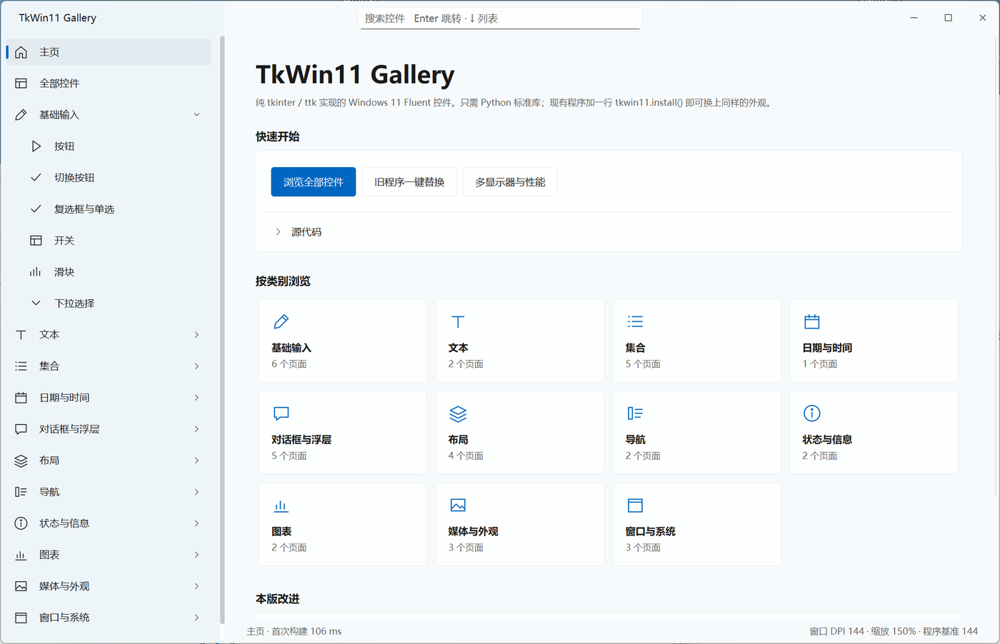
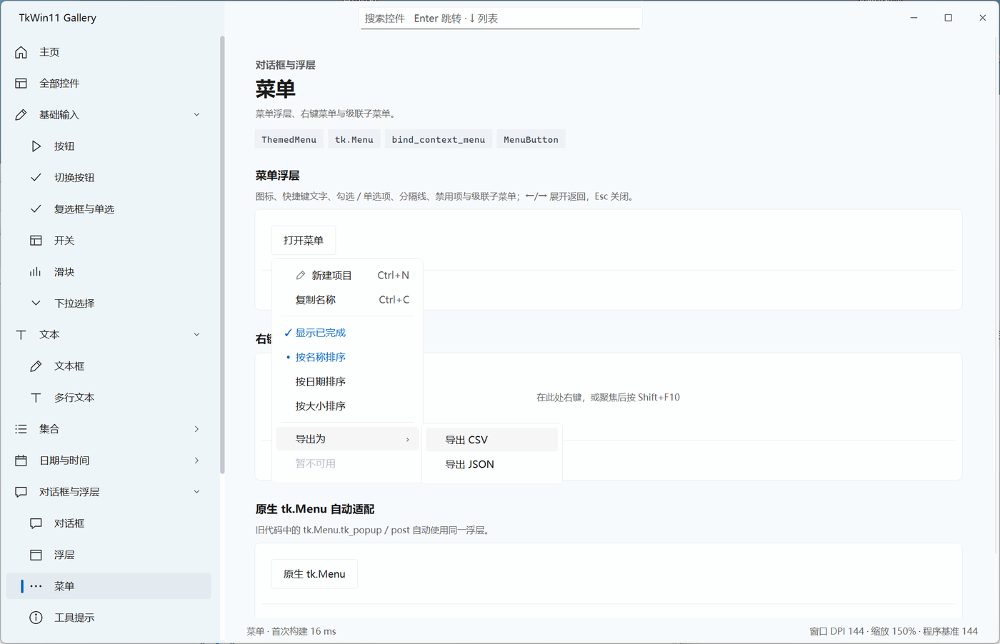
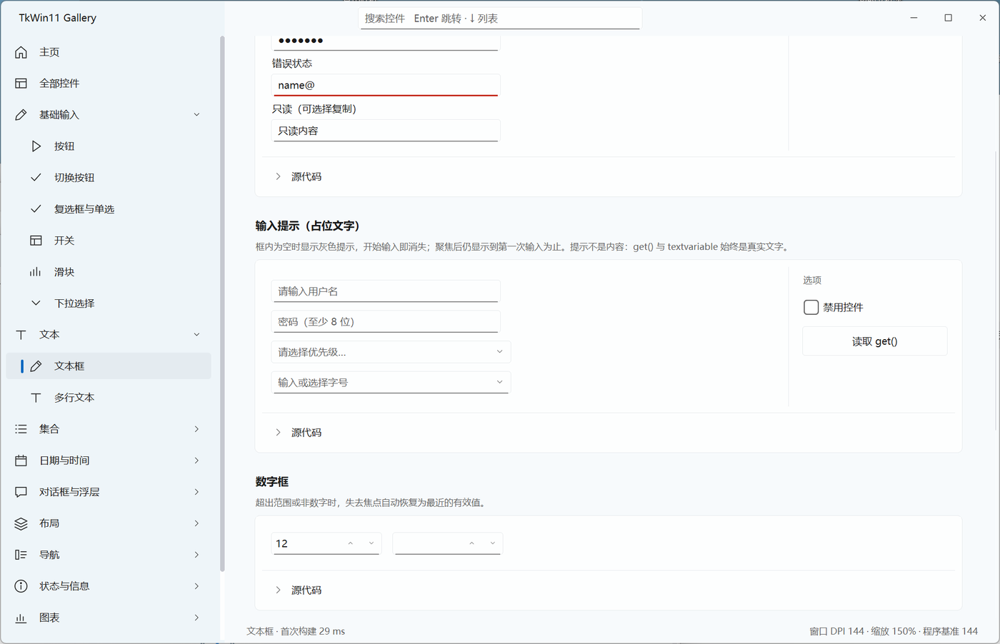

# TkWin11

纯 tkinter / ttk 实现的 Windows 11 Fluent 风格主题与控件库。只需要 Python 标准库；现有的 tkinter 程序加一行代码就能换上同样的外观。



- **一行换肤**：旧程序在创建 `tk.Tk()` 前调用 `tkwin11.install()`，ttk 控件、`tk.Entry/Text/Listbox`、`tk.Menu` 弹出菜单和经典 Button / Label / Frame 等全部换上 Win11 外观，代码其余部分不用改。
- **Fluent 控件**：一体化标题栏、层级导航、设置卡片与展开卡片、圆角浮层菜单、下拉浮层、开关、滑块、输入提示、对话框、通知、表格、图表等，带悬停 / 按下 / 焦点 / 禁用状态和可中断的过渡动画。
- **多显示器**：每块显示器按自己的缩放比例适配字体、图片和尺寸，窗口拖到另一块屏幕后自动重新适配。
- **Gallery**：仿 WinUI 3 Gallery 的完整演示，每个示例都能查看源代码。

## 快速开始

把 `tkwin11` 文件夹复制到自己的脚本旁边即可，无需安装第三方包。

**运行 Gallery**：双击 `main.py`，或

```bash
python main.py
python main.py --page menu        # 直接打开某一页，例如 button、entry、dpi
```

**旧程序一键替换**：在创建 `tk.Tk()` 之前加一行

```python
import tkwin11; tkwin11.install()

import tkinter as tk
from tkinter import ttk
root = tk.Tk()
tk.Button(root, text='经典按钮').pack()
ttk.Combobox(root, values=['A', 'B'], state='readonly').pack()
root.mainloop()
```

代码里显式设置的颜色（如 `bg='red'`）保持不变；之后调用 `ttk.Style().theme_use('clam')` 也不会覆盖主题。硬编码像素尺寸、依赖系统位图缩放的程序可以用 `install(dpi=False)`。已经创建好窗口的程序可直接调用 `apply_theme(root)` 与 `theme_classic(root)`。

**新程序**：

```python
import tkinter as tk
import tkwin11 as ui

ui.enable_dpi_awareness()            # 必须在 Tk() 之前
root = tk.Tk()
ui.apply_theme(root)
ui.configure_fluent(root)

page = ui.FluentPage(root)
page.pack(fill='both', expand=True)
card = ui.SettingsCard(page.body, '自动保存', '退出时保存当前设置。', symbol='folder')
card.pack(fill='x')
ui.FluentSwitch(card.actions, variable=tk.BooleanVar(root, value=True)).pack()
ui.PlaceholderEntry(page.body, placeholder='请输入名称').pack(fill='x', pady=12)
root.mainloop()
```

## 截图

| 菜单浮层与级联子菜单 | 输入提示（占位文字） |
| --- | --- |
|  |  |

## 组件一览

| 类别 | 组件 |
| --- | --- |
| 原生 ttk / tk 控件（自动套用） | Button、Entry、Combobox、Spinbox、Checkbutton、Radiobutton、Scale、Progressbar、Notebook、Panedwindow、Treeview、LabelFrame、Separator、Sizegrip；tk.Entry / Text / Listbox / Menu 及经典 Button、Label 等 |
| 基础输入 | FluentButton（主要 / 轻量 / 语义色）、ToggleButton、ToolButton、SegmentedControl、FluentSwitch、FluentSlider、ValueSlider、ThemedCombobox、Dropdown、MenuButton、OptionMenu |
| 文本 | PlaceholderEntry / set_placeholder、ValidatedEntry、RoundedText、set_readonly、KeyChord |
| 集合 | RoundedListbox、SortableTreeview、DataTable（搜索 / 筛选 / 分页 / 导出）、Spreadsheet（Excel 式单元格表格）、CardList |
| 日期与时间 | DateEntry、CalendarPopup |
| 对话框与浮层 | Modal、Dialogs（提示 / 确认 / 输入）、FormFlyout、ThemedMenu、bind_context_menu、Tooltip、notify |
| 布局与导航 | FluentPage、SettingsCard、ExpanderCard、Accordion、SettingRow、Card、SectionCard、NavigationView、Sidebar、ScrollArea |
| 状态与图表 | TextProgress、Meter、Badge、LineChart、ColumnChart、ScatterChart、DonutChart、PieChart、BarChart |
| 媒体与外观 | ImageViewer、ColorPicker / ColorDialog、FontPicker / FontDialog、icon |
| 窗口 | FluentTitleBar、FluentWindowChrome（原生拖动、Win11 贴靠、边缘缩放、最大化）、enable_dpi_awareness |

每个组件的用法都能在 Gallery 对应页面的“源代码”里找到。

## 环境与限制

- 在 Windows 11、Python 3.11 上开发和测试，包括 150% 与 125% 双显示器。一体化标题栏与每显示器 DPI 适配只在 Windows 上启用，其他平台保留系统标题栏。
- 只依赖 Python 标准库（tkinter、ctypes 等）。
- 目前只有浅色主题；Tk 无法提供 WinUI 的 Mica / Acrylic 材质，浮层与动画由 Tk 自行绘制，不能保证逐帧达到原生 WinUI 的流畅度。

## 与 TkWebUI 的关系

TkWin11 由 [TkWebUI](https://github.com/bvb6417/tkwebui) 分支而来，改为 Windows 11 / Fluent 外观，并增加了一体化标题栏、导航、设置卡片、每显示器 DPI、一键替换等功能。原有的 `Spreadsheet`、`DataTable`、`ThemedCombobox`、`LineChart` 等接口保留，导入名从 `tkwebui` 改为 `tkwin11`。同一个 Tk 解释器里不要混用两个库。

更新记录见 [CHANGELOG.md](CHANGELOG.md)。

## 许可证

[MIT](LICENSE)
